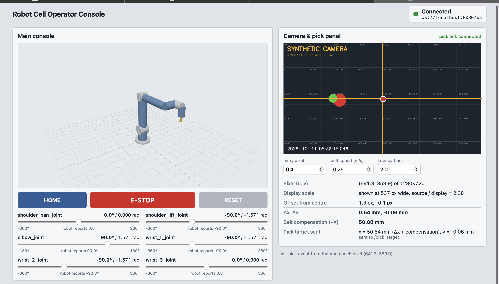

# Robot Cell Operator Console

A browser console for a small pick cell (one 6-axis arm, one overhead camera).
Part A (React) shows and drives the robot, Part B (Vue 3) shows the camera and turns clicks into pick targets,
Part C (ROS 2) is the backend.

## Run it

```bash
git clone https://github.com/Aniket8767/robot-cell-console.git
cd robot-cell-console
docker compose up --build
```

Then open **http://localhost:8080**. Nothing else is needed (no Node, ROS or Python on the host).
Stop with `Ctrl+C`; clean up with `docker compose down`.



## What it is built from

| Item | Choice |
|---|---|
| ROS | **ROS 2 Lyrical Luth** (`ros:lyrical-ros-base`). If its apt packages are unavailable: `ROS_DISTRO=jazzy docker compose up --build` |
| Robot | **UR5e kinematics, hand-written URDF** (`backend/urdf/ur5e.urdf`): 6 revolute joints, every joint origin derived from Universal Robots' published UR5e DH parameters, limits from the UR5e datasheet. Visuals are simple cylinders (no mesh files). Forward kinematics were checked against the DH model (max error 1e-8 m over 200 random poses). It is *not* the official `ur_description` package. |
| Front end | React 19 + three.js + `urdf-loader` (Part A), Vue 3 custom element (Part B), built with Vite |
| Camera transport | MJPEG over HTTP, plus `sensor_msgs/CompressedImage` on `/camera/image/compressed` |
| Web server | nginx, one port (8080) for UI, websocket (`/ws`) and camera/config (`/api/`) |

Architecture, topics, units and all maths are in [DESIGN.md](DESIGN.md).

## Configuration

Everything tunable is in **`config/cell.yaml`**: `mm_per_pixel` (0.4), belt speed (0.25 m/s), latency (200 ms),
home pose, ROS ports, camera device/size/fps, max joint velocity. Edit it and run `docker compose up --build` again.
The one thing duplicated outside it: the two backend ports are also in `frontend/nginx.conf` (noted in both files).

## How to verify each requirement

Watch the backend log in another terminal with `docker compose logs -f backend` (or just read the `docker compose up` output).

| Check | Steps | Expect |
|---|---|---|
| Sliders / round trip | Drag a joint slider | Robot moves smoothly (max 1 rad/s). The small "robot reports" line comes from `/joint_states`, the 3D model is driven only by that topic. |
| Deg / rad / limits | Look at any slider | Joint name, degrees and radians; ends of the slider are the URDF limits (elbow +-180 deg, others +-360 deg). |
| HOME | Press HOME | All joints glide to the pose in `cell.yaml` (tool pointing down). |
| E-STOP | Press E-STOP | Red banner, sliders and HOME disabled, robot stops. Log: `E-STOP LATCHED`. |
| E-STOP is enforced on the server | While latched, run `docker compose exec backend bash -c 'source /opt/ros/$ROS_DISTRO/setup.bash && ros2 topic pub --once /joint_command sensor_msgs/msg/JointState "{name: [shoulder_pan_joint], position: [1.0]}"'` | Robot does not move; log shows `E-STOP active: REJECTED joint command`. |
| RESET | Press RESET | Banner gone, sliders enabled, commands work again. Log: `E-STOP RESET`. |
| Camera | Look at the right panel | Live image, yellow crosshair at the centre. |
| Pick maths | Click the image | Panel shows pixel (u,v) in *source* pixels, offset in px, dx/dy in mm, belt compensation (default 50 mm), and the sent target. Log: `PICK TARGET RECEIVED`. The synthetic image has a labelled grid (every 160 px) so you can check by eye. |
| Display scaling | Resize the browser window and click again | Same grid label gives the same (u,v) at any display size. |
| Reconnect | `docker compose stop backend` then `docker compose start backend` | Badge turns red (URL shown), then green again by itself; sliders and camera recover. |
| TF tree | `docker compose exec backend bash -c 'source /opt/ros/$ROS_DISTRO/setup.bash && ros2 run tf2_ros tf2_echo base_link tool0'` | Prints a transform that changes when joints move. |
| Rates | `... ros2 topic hz /joint_states` and `... ros2 topic hz /camera/image/compressed` | about 30 Hz and about 10 Hz. |
| No-camera fallback | Default on macOS/Windows; on Linux run `NO_CAMERA=1 docker compose up --build` or just have no `/dev/video0` | Log `NO CAMERA ... Publishing a SYNTHETIC image instead`; image says "SYNTHETIC CAMERA"; everything else behaves the same. |
| Offline | `docker compose build`, disconnect the network, `docker compose up` | Works; nothing is downloaded at start. |
| Unit tests | `docker build --target vue-test -f frontend/Dockerfile .` | pickMath tests pass. |

### Camera access

`docker-compose.yml` runs the backend with `privileged: true`. A `devices: ["/dev/video0:/dev/video0"]` line would make
`docker compose up` fail on machines without a webcam; privileged mode sees `/dev/video*` if it exists and starts
cleanly if it does not. Trade-off: it grants the backend container broad device access. On a machine that has a
webcam you can tighten this by replacing `privileged: true` with the `devices:` line. A real webcam only works with
Docker on Linux; Docker Desktop on macOS/Windows cannot pass USB cameras through, so those use the synthetic image.

## What works / what doesn't / what I'd do next

The application has been launched successfully on macOS using Docker Compose. The robot console and synthetic camera panel are displayed in the browser. Additional functional checks are still required to verify all features before submission. The verification checklist below should be updated based on the actual test results.

**Works (designed, to be confirmed by your run):**
- Single-command build and run, one URL, no runtime downloads, starts without a camera.
- React console: URDF 3D view, 6 sliders with URDF limits and deg/rad, state driven by `/joint_states`, HOME, E-STOP/RESET, connection badge with URL and auto-reconnect.
- Vue 3 panel (mounted as a custom element): live MJPEG, crosshair, click to px to mm with display scaling, belt compensation, publishes `/pick_target`.
- Backend: rosbridge, robot_state_publisher with TF `base_link` to `tool0`, `/joint_states` at 30 Hz, server-side E-STOP, camera with synthetic fallback, pick target logging.

**Known limitations (honest list):**
- The robot model is hand-written with primitive shapes, not the official UR meshes.
- The robot is a simulation (velocity-limited interpolation), no dynamics or collision checking.
- No webcam passthrough on Docker Desktop (macOS/Windows); synthetic image is used there.
- The published pick target is `dx + belt compensation` in the `camera_center` frame (millimetres); there is no transform into `base_link` and the robot does not move to it.
- If a real webcam stops delivering frames, the node switches permanently to the synthetic image until restart.
- The MJPEG `` may freeze when the backend restarts; the panel reloads it when the websocket reconnects.
- `privileged: true` is broader than ideal (see above).
- Two port numbers are duplicated between `cell.yaml` and `nginx.conf`.
- npm versions use caret ranges and no lockfile is committed unless you add one (`npm install --package-lock-only` in each app).

**Next:** commit lockfiles, swap in the official UR5e meshes, add a TF transform of the pick point into `base_link`, add IK.

## Bonus items attempted

1. **Smooth motion**: the backend moves each joint toward its target at most `max_joint_velocity_rad_s` (1.0).
2. **Unit tests**: pixel to mm, display scaling and latency compensation (`frontend/vue-panel/src/utils/pickMath.test.js`, Vitest).

## Size and build time

Measure on your machine and fill in:

```bash
docker image ls robot-cell-backend robot-cell-web
```

- Image sizes: Backend **673 MB** (2.88 GB disk usage), Web **22.1 MB** (77.2 MB disk usage).
- Cold build time: **TODO** (about ___ min)

## Licence and attribution

- Robot kinematic parameters are Universal Robots' published UR5e DH values. The URDF and its primitive visuals are original to this project; it is not derived from the `ur_description` meshes. UR5e is a trademark of Universal Robots.
- Backend images are based on the official `ros` Docker image (ROS 2, Apache-2.0 / BSD); rosbridge_suite (BSD-3-Clause).
- Front end: React (MIT), Vue (MIT), three.js (MIT), urdf-loader (Apache-2.0), Vite (MIT).


## Verification Checklist

Use the following checks when running the application locally:

- [ ] Start the application with `docker compose up --build`.
- [ ] Open `http://localhost:8080`.
- [ ] Check the robot joint sliders and HOME control.
- [ ] Check camera interaction and pick-target calculations.
- [ ] Verify that E-STOP blocks commands and RESET restores operation.
- [ ] Confirm that the application works without a physical camera.

Record the actual results of these checks before submitting the project.
